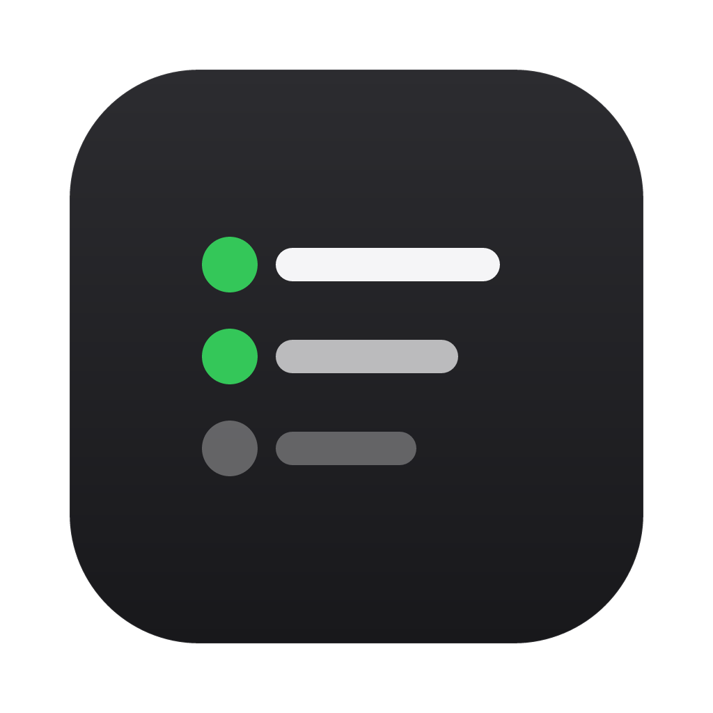
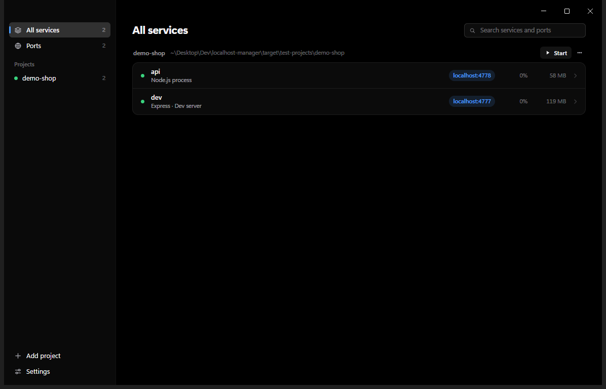

<p align="center">
  
</p>

<h1 align="center">Localhost</h1>

<p align="center">
  A calm desktop app that turns the processes and ports on your machine into projects and services you can read at a glance.
</p>

<p align="center">
  <a href="https://github.com/liwidale/localhost/releases/latest"></a>
  <a href="https://github.com/liwidale/localhost/actions/workflows/ci.yml"></a>
  
  <a href="LICENSE"></a>
</p>

<p align="center">
  
</p>

<p align="center"><sub>Localhost on Windows 11, with a dev server it started and an API it found running.</sub></p>

After a day of work you have a dozen terminal tabs, a database you installed months ago and containers from three Compose files, and you no longer know what owns port 3000. Localhost reads what is running, works out which project each process belongs to and what it is, and shows it as a short list: `shop` › `frontend` › Next.js on `localhost:3000`. Select a service to see its health, logs, environment and process tree, and to open, restart or stop it.

## Contents

- [Download](#download)
- [What you get](#what-you-get)
- [Getting started](#getting-started)
- [Everyday use](#everyday-use)
- [Privacy and security](#privacy-and-security)
- [Troubleshooting](#troubleshooting)
- [Building from source](#building-from-source)
- [How it works](#how-it-works)
- [Project structure](#project-structure)
- [Contributing](#contributing)
- [License](#license)

## Download

Get the latest version from the [releases page](https://github.com/liwidale/localhost/releases/latest).

| Platform | File | Requirements |
| --- | --- | --- |
| macOS | `Localhost-<version>-mac.dmg` | macOS 12 or later, Apple silicon or Intel |
| Windows | `Localhost-Setup-<version>.exe` | Windows 10 or 11, 64-bit |
| Linux | `Localhost-<version>.AppImage` or `.deb` | A 64-bit desktop distribution |

## What you get

- **Projects instead of PIDs.** Localhost groups processes by repository and package folder, so a monorepo shows `shop` › `frontend`, `backend` and `postgres` rather than six `node` processes.
- **It knows what it is looking at.** About 100 tools are recognized, from Next.js, Vite and Django to PostgreSQL, Redis and Mailpit. Project dependencies refine the guess, and the inspector tells you why it thinks so.
- **Ports explain themselves.** Type `3000` in the search field to see what owns the port, or read that it is free. Ports with more than one listener are marked.
- **Health, not only presence.** A short request to each new service tells you whether it actually responds, with the HTTP status and latency.
- **Logs without Terminal.** Services you start from Localhost and Docker containers stream their output into a fast log viewer with colors, filtering, pause and timestamps.
- **Start what your project already defines.** `package.json` scripts, Deno tasks, `cargo run`, Django and `docker compose up` appear under **Start**, using the package manager your lockfile names.
- **Conflicts you can fix in place.** When a service fails because its port is taken, Localhost shows who holds the port and offers to stop it.
- **Careful with destructive actions.** Stop sends the equivalent of Control-C. Force quit asks first and says how many processes end. Stopping a service Localhost started can be undone.
- **Secrets stay hidden.** API keys, tokens and passwords in environments, arguments and logs are masked before they reach the window.
- **Quiet and fast.** The window refreshes every 2 seconds while visible and every 10 seconds in the background. The Rust engine that does the work uses about 10 MB of memory.
- **Light, dark and Russian.** Follows your system theme or a fixed one, with reduced motion if you prefer. The interface is available in English and Russian.

## Getting started

1. Install Localhost and open it.
2. Your running dev servers, databases and containers appear grouped by project. System services stay hidden until you ask for them.
3. Select a service. Its page shows addresses, command, folder and resource use, with tabs for logs, environment and processes.
4. To run something, press **Start** next to a project and choose a script. The first time, Localhost shows the exact command and asks you to confirm.
5. To keep a project in the list while nothing runs, open its **⋯** menu and choose **Keep in Localhost**, or press **+** in the toolbar and choose its folder.

## Everyday use

| Task | How |
| --- | --- |
| Find what uses a port | Type the port number in the search field |
| Open a service in the browser | Click its address, or press `Ctrl+Enter` or `⌘↩` on its page |
| See logs | Open the service and choose **Logs** |
| Capture logs for a process started elsewhere | **Restart** it. Localhost stops it and runs the same command in the same folder |
| Stop a service | **Stop** in the inspector, or right-click the row |
| See everything on one screen | Switch to **Ports** |
| Open a terminal or editor in the project | Right-click the project or service |
| Go back to the list | `Esc` |

Keyboard shortcuts: `/`, `Ctrl+F` or `⌘F` search, `Ctrl+R` or `⌘R` refresh, `Ctrl+O` or `⌘O` add a project, `Ctrl+,` or `⌘,` settings, `Ctrl+Backspace` or `⌘⌫` stop the open service.

## Privacy and security

- **Nothing leaves your machine.** Localhost has no telemetry, no analytics and no network access beyond the local services it checks.
- **Local probes only.** Health checks connect to `localhost` and only to services that are not system services. Turn them off in **Settings**.
- **No administrator rights.** Processes that belong to another user or to the system are shown but cannot be controlled.
- **No shell.** Commands run as a program and an argument list, never as a shell string.
- **Trust per project.** Scripts from a project run only after you confirm the first one.
- **Secrets are masked in Rust**, before anything reaches the window. Revealing a value is an explicit action that reads only that variable.
- **A sandboxed window.** The interface cannot reach the network or your files. It talks to the engine only through a fixed set of commands.

Details are in [docs/architecture.md](docs/architecture.md#security).

## Troubleshooting

- **A service shows no logs.** Localhost can read output only from services it starts and from containers. Use **Restart** to run the service under Localhost.
- **Stop did not work.** Some programs ignore Control-C. After six seconds Localhost offers **Force quit**.
- **A script fails with "couldn't find pnpm".** On macOS and Linux, Localhost reads `PATH` from your login shell. Make sure the tool is on `PATH` in a new terminal, then restart Localhost.
- **A service on Windows shows as "WSL".** The process runs inside WSL. Windows only sees the port forward, so Localhost cannot show the process inside.
- **Containers are missing.** Localhost looks for the Docker socket or named pipe. If you use a custom location, set `DOCKER_HOST` before opening Localhost.

## Building from source

You need Rust 1.95 or later and Node.js 24.

```bash
npm install
```

```bash
npm run dev
```

```bash
npm run pack:win
```

`npm run dev` builds the engine in debug mode and opens the app. `npm run pack:win`, `npm run pack:mac` and `npm run pack:linux` build the release engine and write installers to `release/`.

Checks:

```bash
cargo fmt --all --check && cargo clippy --workspace --all-targets -- -D warnings && cargo test --workspace
```

```bash
npm run lint && npm run typecheck
```

To print what the engine sees without the window:

```bash
cargo run -p localhost-core --example snapshot
```

## How it works

Localhost is Rust first. The `localhost-engine` binary reads the process table with `sysinfo`, reads listening sockets straight from the OS (`GetExtendedTcpTable` on Windows, `/proc/net/tcp` on Linux and `libproc` on macOS) and talks to Docker over its socket. It groups processes into services by walking up the process tree, matches them against a signature table, finds project roots from manifests and Git, and publishes a snapshot every 2 seconds. Electron starts the engine as a child process and exchanges JSON lines with it over stdin and stdout. The window is a sandboxed React interface built on the Kumo design system.

Read [docs/research.md](docs/research.md) for the decisions and the alternatives considered, and [docs/architecture.md](docs/architecture.md) for the modules, protocol, security model and platform differences.

## Project structure

```
crates/localhost-core/    Engine library: processes, sockets, detection, health, logs, Docker
crates/localhost-engine/  Engine binary that Electron talks to over stdio
src/main/                 Electron main process: window, menus, dialogs, notifications
src/preload/              The window.localhost bridge
src/renderer/             React interface
src/shared/               Types, API contract and translations
scripts/                  Build and packaging scripts
docs/                     Research and architecture
branding/                 Icon source and 1024 px PNG
```

## Contributing

Issues and pull requests are welcome.

- Keep logic in `localhost-core` and keep Electron and React presentational.
- New tools go in `crates/localhost-core/src/detect/signatures.rs` with a test in `detect/mod.rs`.
- Every user-facing string goes through `tr()` and gets a Russian entry in `src/shared/locales/ru.ts`.
- Run the checks above before opening a pull request.

## License

[MIT](LICENSE) © 2026 Liwidale

Localhost is not affiliated with Docker, Vercel, Apple, Microsoft, Electron or any tool it recognizes. Their names belong to their owners.

<p align="center"><sub>ゝ made by <a href="https://github.com/liwidale">liwidale</a></sub></p>
